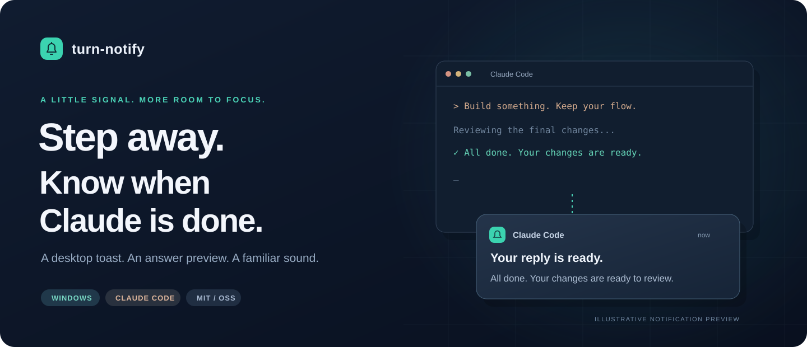

<p align="center"></p>

<p align="center">
  <a href="https://github.com/Gongkddz/claude-turn-notify/releases/latest"></a>
  <a href="LICENSE"></a>
  
  
</p>

<p align="center"><strong>Step away. Know when Claude is done.</strong><br>Native Windows notifications · Answer previews · System sound · Local execution</p>

<p align="center">
  <strong>English</strong> · <a href="README.zh-CN.md">简体中文</a>
</p>

<p align="center">
  <a href="#ask-your-agent-to-install">Ask your agent to install</a> ·
  <a href="https://github.com/Gongkddz/claude-turn-notify/releases/latest">Download</a> ·
  <a href="docs/INSTALL.md">Installation guide</a> ·
  <a href="AGENTS.md">For agents</a>
</p>

---

Switch to something else while Claude Code works. `turn-notify` plays a system sound and sends a Windows toast with a short answer preview about three seconds after a reply ends. It installs through Claude Code's native plugin system, with no manual hook configuration.

## Ask your agent to install

Send this to an **agent running on your Windows computer with terminal access**:

```text
Install https://github.com/Gongkddz/claude-turn-notify for me.
Read AGENTS.md, check requirements, install through Claude Code's native plugin
system, verify installation, and explain how to enable, mute, and test notifications
in my preferred language.
```

The agent can follow [AGENTS.md](AGENTS.md), the [plain-text llms.txt map](llms.txt) and the [installation guide](docs/INSTALL.md) to check the environment, install the plugin, verify registration and explain the controls. An agent without local terminal access will need a way to run the commands on your computer.

<details>
<summary><strong>Prefer to install it yourself? Copy these two commands.</strong></summary>

Run in PowerShell:

```powershell
claude plugin marketplace add Gongkddz/claude-turn-notify
claude plugin install turn-notify@claude-turn-notify --scope user
```

Open a **new Claude Code session**. Run `/turn-notify:status`, then `/turn-notify:test` to check the notification.

</details>

## Download and install

**[Download the Windows ZIP →](https://github.com/Gongkddz/claude-turn-notify/releases/latest/download/claude-turn-notify-1.0.0-windows.zip)**

Extract the entire ZIP, double-click `install.cmd`, then open a new Claude Code session. The bundle includes the complete plugin, installer and documentation. It uses Windows PowerShell and needs no compilation, additional Node/Python runtime or administrator access. **Claude Code CLI must already be installed.**

The installer keeps a durable marketplace at `%LOCALAPPDATA%\ClaudeTurnNotify\marketplace\1.0.0`, so you can remove the downloaded ZIP and extracted folder afterward. Downloads and GitHub installation need network access; the notification script itself makes no network requests. To change an existing marketplace source, follow [Switch installation source](docs/INSTALL.md#switch-installation-source).

## Small details that keep you in flow

| Feature | Behavior |
| :--- | :--- |
| Desktop notification | Shows Claude Code and a preview of its last answer |
| Familiar sound | Uses the Windows notification sound; the toast itself stays silent to avoid double playback |
| Short preview | Cleans common Markdown and keeps up to about 90 characters |
| Fewer interruptions | Merges rapid Stop events within three seconds per session; separate sessions stay independent |
| Persistent mute | Remembers the local on/off switch across sessions |
| Agent-ready installation | Standard marketplace manifest, explicit runbook, plain-text entry point and in-plugin help |

## Five commands

| In Claude Code | Action |
| :--- | :--- |
| `/turn-notify:on` | Enable notifications |
| `/turn-notify:off` | Mute notifications |
| `/turn-notify:status` | Read the saved switch |
| `/turn-notify:test` | Send a sample toast and sound if enabled |
| `/turn-notify:help` | Usage, updates, uninstall and troubleshooting |

## Requirements and privacy

- **Native Windows 10/11, Windows PowerShell 5.1 and plugin-capable Claude Code 2.x.** Installation and scripts were verified on Windows 11 with Claude Code 2.1.319. Windows 10 display and other CLI versions require separate validation.
- An interactive Windows desktop is required. WSL, macOS, Linux and headless sessions are unsupported.
- Windows notification permissions, Do not disturb / Focus assist, volume and output devices affect delivery. Windows controls placement and history; successful installation does not prove a toast was visible.
- The notification script has no telemetry or network requests. Installation and updates use Claude Code/GitHub networking.
- Data lives in `%USERPROFILE%\.claude\turn-notify\`, or under `turn-notify` inside `CLAUDE_CONFIG_DIR` when set: `state.txt`, a rolling `notify.log` (rotated after about 1 MB) and per-session `pending-*.txt` files.
- **Answer previews remain in local pending files and may appear on the lock screen and in notification history.** Logs record technical events without answer text, transcript paths or session IDs. Without a valid current-session source, the plugin uses a generic completion message.

## Update and uninstall

For a GitHub installation:

```powershell
claude plugin marketplace update claude-turn-notify
claude plugin update turn-notify@claude-turn-notify
```

For a ZIP installation, download the new version and follow [Switch installation source](docs/INSTALL.md#switch-installation-source) to register its local marketplace. Open a new session after updating.

Uninstall a user-scope installation:

```powershell
claude plugin uninstall turn-notify@claude-turn-notify --scope user
```

Notification data is not automatically deleted. Project/local installations need the matching `--scope project` or `--scope local`.

## Development and packaging

The project consists of PowerShell scripts and plugin manifests with no third-party runtime libraries. After cloning, run:

```powershell
claude plugin validate .
claude plugin validate ./plugins/turn-notify
powershell.exe -NoProfile -ExecutionPolicy Bypass -File ./scripts/build-release.ps1
```

The ZIP and SHA-256 checksums go to ignored `dist/`. Packaging selects distribution inputs explicitly and preserves hidden `.claude-plugin` directories. See [turn-notify.ps1](plugins/turn-notify/scripts/turn-notify.ps1) for the hook and [CONTRIBUTING.md](CONTRIBUTING.md) for maintenance guidance.

## License and acknowledgments

Original code and artwork are [MIT licensed](LICENSE). The project uses [Claude Code's plugin marketplace](https://code.claude.com/docs/en/plugin-marketplaces), the [Stop hook](https://code.claude.com/docs/en/hooks#stop) and Windows notification/sound APIs. See [third-party notices](THIRD_PARTY_NOTICES.md). This is an independent community project.
